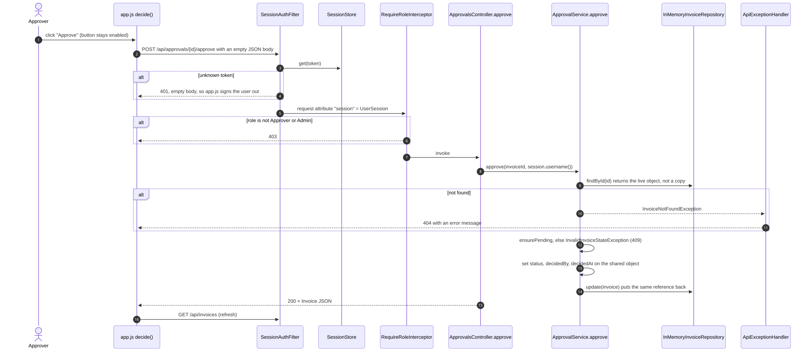
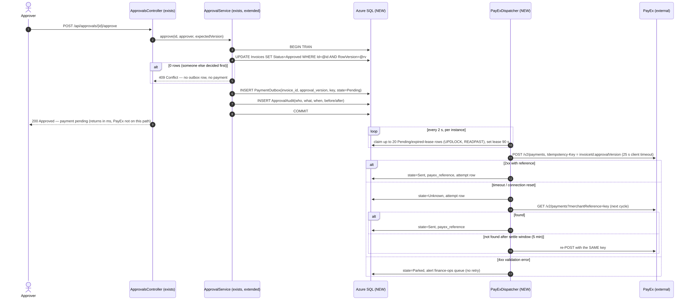

# Diagrams

<!-- Generated by scripts/diagrams/sync_diagrams.py from the .mmd files. Edit the .mmd, not this page. -->

Every diagram here is **diagram-as-code**: it's written as Mermaid text in a `.mmd` file in this folder, and the picture is generated from that text. Nothing is drawn by hand. That means a diagram change is a text diff that gets reviewed in a PR like any other code.

For each diagram below you'll find:

1. **The picture** (an SVG generated from the source with mermaid-cli).
2. **The exact Mermaid source.** Copy it into [mermaid.live](https://mermaid.live) or any Mermaid renderer to reproduce the picture.
3. **A one-click link** that opens the same source in the Mermaid Live Editor.

The same diagrams also render live inside the documents that explain them, where every box carries a citation to the code.

| Diagram | Source file | Explained in |
| --- | --- | --- |
| As-built: container view | [`as-built-container.mmd`](as-built-container.mmd) | [as-built.md](as-built.md#container-view) |
| As-built: approval sequence | [`as-built-approval-sequence.mmd`](as-built-approval-sequence.mmd) | [as-built.md](as-built.md#sequence-approving-an-invoice) |
| Target: container view | [`target-container.mmd`](target-container.mmd) | [target-state.md](target-state.md#container-view) |
| Target: approval and payment sequence | [`target-approval-sequence.mmd`](target-approval-sequence.mmd) | [target-state.md](target-state.md#approval-and-payment-sequence) |

## As-built: container view

What runs today: one JVM, two Maven modules. The domain module has no framework in it.



**Mermaid source** ([`as-built-container.mmd`](as-built-container.mmd)):

```text
flowchart LR
    user["Approver / Admin<br/>(browser)"]

    subgraph jvm["One JVM — Spring Boot 3 on Java 21, port 5000"]
        direction LR
        subgraph apimod["Maven module invoice-api (adapter)"]
            ui["Static UI<br/>resources/static: index.html + app.js"]
            filter["SessionAuthFilter<br/>bearer token on /api/*"]
            ctrl["web/ controllers<br/>Auth · Invoices · Approvals"]
            roles["RequireRoleInterceptor<br/>@RequireRole, 403"]
            advice["ApiExceptionHandler<br/>404 / 409 / 400"]
            repo[("InMemoryInvoiceRepository<br/>ArrayList + synchronized")]
            sessions[("SessionStore<br/>ConcurrentHashMap")]
            cfg["application.yml demo.users<br/>DemoUsersProperties"]
        end
        subgraph dommod["Maven module invoice-domain (plain Java, no framework)"]
            svc["ApprovalService"]
            port["InvoiceRepository (port)"]
        end
    end

    user -->|HTTP| ui
    ui -->|"fetch /api/* + Bearer"| filter
    filter -->|lookup token| sessions
    filter --> roles
    roles -->|"role ok"| ctrl
    ctrl -->|"submit / approve / reject"| svc
    ctrl -->|"findAll / add / remove (direct)"| port
    svc --> port
    port -. implemented by .-> repo
    ctrl -.->|domain exceptions| advice
    ctrl -->|"login: compare username + password"| cfg
    ctrl -->|"create / remove token"| sessions
```

[Open in the Mermaid Live Editor](https://mermaid.live/edit#pako:eNp9VF1PGzEQ_Cure0rakByQqiqqUENpRSqiIgJ94frg2JvE4LNd25eQEv57177j81DvIbHX3vHseNZ3GTcCswPI5sqs-ZK5AKfnhQb6Ko_uqshG1jqzQgcDGIlS6s8zNzjszJxZ03q3yH4Xut7vq9nCMbuE61VJeT81wo9fEyiqvXx3CFPrpF7AkTEB9sFo-MFWDPZ2e2ANHfohz_OEBc0npEMeJG184PPiDGZlaQQdM2Er1EDjSiFIvTKS4w6tQocJZsMDRXj2VZLypoEFyeFynOpx6E3lOPqBT_EDghJ421-GUsF7Os32r30LaC5VSBpN0XuiOqrC8nuKJdAZMke6BXNDDKmQAdEavGuh8OAUYaxxNgBudHBGKXQ-QUREUjDPZx9hXBfnH-b1xTDV5kUI6AnyHP9UJOM5TceaWHG0wdTcvjxb68Ew32-BMLGi05IB5LfbmEoVnjAtVFPeMB-SJ4b5p_Sbt1mgNVedIhvrCZbGbRr-5xT2knhs6gqdY5tT6QPJ7DeaL53R8i-KIuu-wvO1yD5iNoJPCQYTzFejeeUc6nDC_HLCbDufzxdUDV2lkpzFYvobulxB3PrR6rXgxzS9jLMzZyy6IPGlvKjFG24UpvyPG2mVSQ0dq-Jf9H0PtIG5YyWujbtpO9Sv-GPnMTVFF6-itSs2zlXU95WudBKtdN_mnQZPDQ47O4fbk4uLsy21RROWKVhkcwx82biWbuco2bnIto3v6931OGUoY24qW_t9-3hdr7fV7qyjadicFsdgbiJ-7Ih6Qxw16yR2KQN5jdUPEo0cXtMbETNIsFbCnFp4pFTMECLtLmNap35ZujEt6tQ8XiueyD1F0rO00wdZWoUlGQsFzDbQjxWQ1M-Po9i2uWR86BS_bTqoxUuZhdQH1OqlJUHTLWhyAilsmfdkCJE0mC9amdwhC_hUSlI6lf-oddaDrERHXER81e-KLCyJfUGTIhM4Z5Uiwe7jNlYFM6WOo6XgKnoFssoKwj-WjFxdNuH7f54P-NE=)

## As-built: approval sequence

Step 9: `findById` returns the live object. That is the root of the double-approve race.



**Mermaid source** ([`as-built-approval-sequence.mmd`](as-built-approval-sequence.mmd)):

```text
sequenceDiagram
    autonumber
    actor A as Approver
    participant JS as app.js decide()
    participant F as SessionAuthFilter
    participant SS as SessionStore
    participant RR as RequireRoleInterceptor
    participant AC as ApprovalsController.approve
    participant S as ApprovalService.approve
    participant R as InMemoryInvoiceRepository
    participant EH as ApiExceptionHandler

    A->>JS: click "Approve" (button stays enabled)
    JS->>F: POST /api/approvals/{id}/approve with an empty JSON body
    F->>SS: get(token)
    alt unknown token
        F-->>JS: 401, empty body, so app.js signs the user out
    end
    F->>RR: request attribute "session" = UserSession
    alt role is not Approver or Admin
        RR-->>JS: 403
    end
    RR->>AC: invoke
    AC->>S: approve(invoiceId, session.username())
    S->>R: findById(id) returns the live object, not a copy
    alt not found
        S-->>EH: InvoiceNotFoundException
        EH-->>JS: 404 with an error message
    end
    S->>S: ensurePending, else InvalidInvoiceStateException (409)
    S->>S: set status, decidedBy, decidedAt on the shared object
    S->>R: update(invoice) puts the same reference back
    AC-->>JS: 200 + Invoice JSON
    JS->>F: GET /api/invoices (refresh)
```

[Open in the Mermaid Live Editor](https://mermaid.live/edit#pako:eNp1VMFy2jAQ_ZUdn8yUJrTNpZ4pMy6FQmaaZuz2xkVYCyjYkiutkjKZ_HtXWOAkpJzw6u3ue29XekwqIzHJIHH4x6Ou8JsSGyuapQb-CU9G-2aFNn5XZCzkIBzkbWvN_fGgFZZUpVqhCa7LcC7a9uLOgcRKSUwH57BZQJXonDI697SdqZreKleWz4Al98dzTFEETMESlMXC1LjQXKvCluHn6HzSCxC1mxhN1tQ12gvRiXqDxPOMEu29qvD_6AObhf6BjbH7hb43jC6wNU4xn_05fjrvyqvp38CZdc6FlnVwowPn78fj6zKDqlbVDpZJNH-ZQLryxDMCR2LvALVY1Sij29clp80yuP1Z_oJL0apLcdR8-ajkU_xEeFC0BaEBm5b2nPbzBlZGRqIzLlJy7w1SSmaHOlYXNYHXO20eNBziXbhLiXyvRh-GsWooOARnjovh1EY7oC2Cd2jBeOryUcu-b1FkYMNiOgJBZBWrRdbvum1g_V_gN6fH7eiJ8TwRlANt6LSpEFZXNuoZ0aLomX561Z_PxuN8koHiAe7ilPNJcCOD6FyquuEuJEvrOFwEOVo0vPPRqDAF1rFWWn7dL2Sq5IBFkbdRf614BGZ1hxUND4QFVKbd92JCbG38kVhXk4tO5xnE7boxNAuI0wL10Om813jVj9patqNhzmKDr5SXnUbUzlu85bDSGx5j7TC0E7WSsWtJgvDUEtKr0efBixIOKWwmeTeMLwFbcPqbE3BWsMBthUUZTXjhmm8l9zj6PIDWU-eaY4vZxjXa8GrBSlS704ii3o-jEbw7OnRY65f34vs0XotY3UHKBS26LatIhpA0aBuhZHgeH5cJd234ymW8fxLXwte0TJ4CLLyS5V5XfETWI0c61vEpjeGnf942yP0=)

## Target: container view

Persistence, the transactional outbox and PayEx. Dashed orange = not built yet. Service Bus is provisioned and deliberately unused in v1.



**Mermaid source** ([`target-container.mmd`](target-container.mmd)):

```text
flowchart LR
    user["Approver / Admin<br/>(browser)"]
    payex["PayEx API<br/>external, 30 s timeout"]:::external

    subgraph app["Azure App Service — 3 instances"]
        direction TB
        ui["Static UI (exists)"]
        api["invoice-api: Spring Boot controllers + auth (exists)"]
        oidc["Entra ID / OIDC sign-in<br/>replaces demo users (NEW)"]:::planned
        domain["invoice-domain, plain Java 21<br/>ApprovalService (exists)"]
        paysub["PaymentSubmission + UnitOfWork port<br/>in invoice-domain (NEW)"]:::planned
        disp["PayExDispatcher<br/>Spring @Scheduled, lease-based (NEW)"]:::planned
        payexc["PayExClient<br/>Spring RestClient, pooled, idempotency key (NEW)"]:::planned
        recon["ReconciliationJob<br/>hourly in month-end window, else daily (NEW)"]:::planned
    end

    subgraph sql["Azure SQL (NEW)"]
        inv[("Invoices<br/>rowversion")]:::planned
        outbox[("PaymentOutbox<br/>unique(invoice_id, approval_version)")]:::planned
        attempts[("PaymentAttempts<br/>one row per send")]:::planned
        audit[("ApprovalAudit<br/>append-only, 7-year retention")]:::planned
    end

    sb[["Azure Service Bus<br/>provisioned, NOT used in v1"]]:::unused

    user --> ui --> api --> domain
    api -.-> oidc
    domain --> paysub
    domain -->|"one transaction:<br/>invoice + outbox row + audit row"| sql
    disp -->|"claim with lease<br/>UPDLOCK, READPAST"| outbox
    disp --> payexc -->|"POST /v2/payments<br/>Idempotency-Key"| payex
    payexc -->|"on Unknown: GET by merchant reference"| payex
    disp -->|"Sent / Unknown / Parked"| outbox
    disp -->|"attempt rows"| attempts
    recon -->|"list PayEx payments vs Sent rows"| payex
    recon -->|"mismatch report, never re-sends"| sql
    outbox -. "later, if a 2nd consumer appears (ADR-001 revisit)" .-> sb

    classDef planned stroke-dasharray: 5 5,stroke:#b45309,color:#7c2d12;
    classDef external fill:#f3f4f6,stroke:#374151;
    classDef unused stroke-dasharray: 2 4,stroke:#9ca3af,color:#6b7280;
```

[Open in the Mermaid Live Editor](https://mermaid.live/edit#pako:eNp9Vu9T2zgQ_Vd2zBcY4pIfUK6-m84FwtykZZocgekHctORbYVosCVXkhNybf_3e5LsEDggH4hZ775dvX27yo8oUzmPEooWhVpnS6YtXV7NJeFTG65v59GwqrRacU1HNMxLIf9I9dHH_VSrNd4fzKN_gnfFNvwB7lO2uXig4XTs_fiD5VqyokODLhmyouSqtghKkqR9N5cBwdTpnWbVklhVubz_1poTstOM65XIOM3rfrd3TAMS0lgmM2622d0nF5pnVihJ12eP1loAa2aZFRndjGmfPwhjzcGTSFY5JyFXCmli_JfQrNJC3tGZUpYyJa1WRcG1oUNitV2-DKNEngHnAt6MxiMQNhmPzsmIOxk3vGleFQyFU85L5Rk2tP_l4utBoAQvpeT5zplUyYTcKS4YOgRPIekTWzHq9zx06BMrWrZeLBFdAs2hTSWXdlanpTDGkXZIN1LYyeKr0vdUKW09KpI8Tf12ucJUrQZGeGY2W3LtgRpC_5zBktcFzztUcGZ4nOJP_iaql1bW4p4XAoXvYl5xY4MVvCjlsQUIrpTlMtvQPd-8iQ_ZKMfxlfvORCGYU9EnlfokS1XrYgMWqIQOljGXOa2FzNW6Q7wwnHImitcTwP1_Ajffi63AZ39fbmMfSwLnt_vzaByoN0E7ao0xdL2aRwcvHgSjlaoHF9i0d-INPrqW4nvN95tmfhPgiDWK-dbAHryGy6wFm9bsIA8bk8dWkhOqowpbwrgDv4ZT58I6kFarQ2fwEKgFgbGSxaZDp_GGM42-oH_2lfPu8prePtLZqP-sDqW5PMIdzoniy-TazVzumrnqgXCHWktnarHcSFIcf8Te8F9YBv47iD_4eNs7GN3AB1MzG84zjNhz88955FjCZpCG-S2VNPPl-4HpC83zPB4GptzzPPrp5NLAYaQasAzzX0KH2EV-jDzYzXR0OTn_3KGri-FoOpxdu-iA-xSgGakGazqZXdPRqn9Uhd4G5saPExR_5hsH5aN21n22PRl2x71Ua5nQXxfXlG6o5Bq3icQZ-IJrgPBnADtnmSEnlmUDgacp0_doySvFI6IRpCPIOLdWoMHRz3PjWWAHUriT2tPRypBP2UbvVLUbisVYugUGo1uHHZLcXYOax07j5klnmubF7wgpGe41bKAFYTdjWQDR1ODDzRtkjYU_HF3F3W4PUE6bFnNHTk4mbVWI7hoz4gtqJE8GF9A9VjAzuKI12yR0QiedYE320uOTQfdDJ1OF0sneadbPe_3fnyG1ty0tRFEke4vB4njxfoswOD3unfSex4TReCF5n463oR8yNmCLNvn79LT_WxdAUYciHBr6z93Pix_zyC55CRUkoCjnC1YX-B3wy7nhRlWzjczwyuqaw1JXOUgcCYZ9WTbmX_8BOCbb7w==)

## Target: approval and payment sequence

PayEx is off the approver's request path. A timeout becomes `Unknown`, and we look the payment up before ever re-sending.



**Mermaid source** ([`target-approval-sequence.mmd`](target-approval-sequence.mmd)):

```text
sequenceDiagram
    autonumber
    actor A as Approver
    participant API as ApprovalsController (exists)
    participant S as ApprovalService (exists, extended)
    participant DB as Azure SQL (NEW)
    participant D as PayExDispatcher (NEW)
    participant P as PayEx (external)

    A->>API: POST /api/approvals/{id}/approve
    API->>S: approve(id, approver, expectedVersion)
    S->>DB: BEGIN TRAN
    S->>DB: UPDATE Invoices SET Status=Approved WHERE Id=@id AND RowVersion=@rv
    alt 0 rows (someone else decided first)
        S-->>API: 409 Conflict — no outbox row, no payment
    end
    S->>DB: INSERT PaymentOutbox(invoice_id, approval_version, key, state=Pending)
    S->>DB: INSERT ApprovalAudit(who, what, when, before/after)
    S->>DB: COMMIT
    API-->>A: 200 Approved — payment pending (returns in ms, PayEx not on this path)

    loop every 2 s, per instance
        D->>DB: claim up to 20 Pending/expired-lease rows (UPDLOCK, READPAST), set lease 90 s
    end
    D->>P: POST /v2/payments, Idempotency-Key = invoiceId:approvalVersion (25 s client timeout)
    alt 2xx with reference
        D->>DB: state=Sent, payex_reference, attempt row
    else timeout / connection reset
        D->>DB: state=Unknown, attempt row
        D->>P: GET /v2/payments?merchantReference=key (next cycle)
        alt found
            D->>DB: state=Sent, payex_reference
        else not found after settle window (5 min)
            D->>P: re-POST with the SAME key
        end
    else 4xx validation error
        D->>DB: state=Parked, alert finance-ops queue (no retry)
    end
```

[Open in the Mermaid Live Editor](https://mermaid.live/edit#pako:eNqVVV9v2joU_ypHeQpSEFzUPQyJ3aUl2tBWmhF294JUufFhWE3szHaArOp333HiFLqxh4sEIsk5x79_dp6CXHEMphAY_FGjzHEu2HfNyo0E-rDaKlmXD6j9dW6VhhiYgbiqtNr3DyqmrchFxaSFOF2cClhhbpS0WhUFagjxKIw1gz-bsvOWDPVe5NiXR4BHi5Ijv9A4v247f9YaIfvyGcJl8u1SmatKWZMc58JUzOY7B-dybfpS6xBY1JIVVNYVxsN374jhFNK7bA0jVgn6eqajJ8Gf_SX68nRBDdkU_N1Q8Kj_rx2xCnOL_D_URijpwWTUMr-ewnXyYbGE9Spevr7_NZ3H6wQWcq9IJgNZsobMMlubmbeFw7ePyYpK-Oy94BAv57BSB7_K7L3eez8LC2PQ6mAgNKpEJRGwMAgcc0F6w1ZoYz2qDkFP_2r8FsjZbSFyC5t6Mv7nCqQCVdsHdXQjI3dZsaZEabsBZOFrHotllqzWTmpXdNe2hqJjdX8SihX3-w55BI_YRGCIK85Smifk98HFmX2U4poLGx52KoLDjln3izTmAbdK44htyd3fBtzc3d4u1if3HOEpTMZjeNHW0_XkoOqAQKjR1loaEBJKSm0XIaksKAl2Jwx12N1LkgqlKkBi1sAEqLyiRApJ3GgXnhSfe1h5wUQJdQVWERjw5EcUIKGRDwtkZFvnJMXj893NpwhWSTxP42w9IMnQQlfzdgzmNz_cGmmf6P1k5IkRpgXHslK0-fJm-AkbmIG3Z8GnvTk-VRBO3oAhnMJpYgWlqe6j43I2OR7hIOwONG5R40WSnbEZDYicuni8fymmMFhLYKwj6fG7pPqFYAS5kpI2k4Oikfj-bfxX-SjVQV4YeKbFh-S1FP-WqPMdnQ6rHtCMogihpAMC8iYv8GyXOLpbVffy_g-Wp4aWnMtOOwjapDoXbYEko-TqAOEbKIUc_LkI4dc4bO1sFbc7Ohvj28TtnrMVenztUldkD5kpOGsVRK2V_puCKdOP6LYnnekEUEgX2aGqDNA7pKZzm3Y-7QXdDM6CFkQQkIglE9y9b542AcEqcUMXm4DjltWF3QTPrsy9drJG5vTI6pqsD-qKcPXvJn_7-RfkbSo5)

## How the pictures are generated

```bash
# 1. Edit a .mmd file. Then regenerate its SVG (Node 18+):
npx -y @mermaid-js/mermaid-cli -i docs/architecture/as-built-container.mmd -o docs/architecture/img/as-built-container.svg -b white

# 2. Push the same source into this page and into as-built.md / target-state.md:
python3 scripts/diagrams/sync_diagrams.py
```

CI runs `sync_diagrams.py --check`, so a PR fails if a document shows a diagram that differs from its `.mmd` source.
