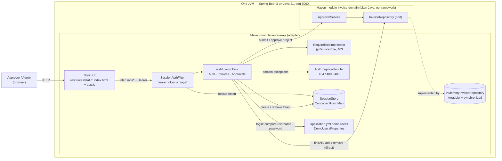
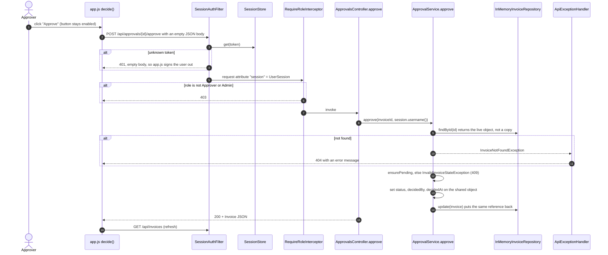

# As-built architecture: Invoice Approval service

This document describes what the code in `backend/` does today. It deliberately ignores everything under `ops/`. That folder describes the production deployment we're planning, not the system that runs now. If a diagram mixes "is" and "will be", nobody can tell which boxes are real, so I keep the two apart.

The service is Java 21 + Spring Boot 3, split into two Maven modules. It's a behaviour-preserving port of the workshop's original ASP.NET Core implementation; why I ported it, and what I kept identical, is in [ADR-002](../decisions/ADR-002-java-spring-boot-port.md).

**Where to see the diagrams:**

- The Mermaid blocks below render directly on GitHub.
- The same diagrams are also exported as SVG, which open anywhere: [container](img/as-built-container.svg), [approval sequence](img/as-built-approval-sequence.svg).
- The editable sources sit next to this file: [`as-built-container.mmd`](as-built-container.mmd), [`as-built-approval-sequence.mmd`](as-built-approval-sequence.mmd).
- [All diagrams in one place](README.md).

## Container view



<details><summary>Mermaid source of this diagram (from <code>as-built-container.mmd</code>), to paste into mermaid.live</summary>

```text
flowchart LR
    user["Approver / Admin<br/>(browser)"]

    subgraph jvm["One JVM — Spring Boot 3 on Java 21, port 5000"]
        direction LR
        subgraph apimod["Maven module invoice-api (adapter)"]
            ui["Static UI<br/>resources/static: index.html + app.js"]
            filter["SessionAuthFilter<br/>bearer token on /api/*"]
            ctrl["web/ controllers<br/>Auth · Invoices · Approvals"]
            roles["RequireRoleInterceptor<br/>@RequireRole, 403"]
            advice["ApiExceptionHandler<br/>404 / 409 / 400"]
            repo[("InMemoryInvoiceRepository<br/>ArrayList + synchronized")]
            sessions[("SessionStore<br/>ConcurrentHashMap")]
            cfg["application.yml demo.users<br/>DemoUsersProperties"]
        end
        subgraph dommod["Maven module invoice-domain (plain Java, no framework)"]
            svc["ApprovalService"]
            port["InvoiceRepository (port)"]
        end
    end

    user -->|HTTP| ui
    ui -->|"fetch /api/* + Bearer"| filter
    filter -->|lookup token| sessions
    filter --> ctrl
    ctrl --> roles
    ctrl -->|"submit / approve / reject"| svc
    ctrl -->|"findAll / add / remove (direct)"| port
    svc --> port
    port -. implemented by .-> repo
    ctrl -.->|domain exceptions| advice
    ctrl -->|"login: compare username + password"| cfg
    ctrl -->|"create / remove token"| sessions
```

[Open this diagram in the Mermaid Live Editor](https://mermaid.live/edit#pako:eNp9VE1zEzkQ_Stdc3KWxB7AFEVqi9qwQCUUqaVi4JLZgyy1YyUaSUgaBy_mv_OkmXwOtXOwpZa6-_Xr1_pRSae4OqRqZdy1XIuQ6ONZYwlfFzmcN9WR98FtONCMjlSr7Z_LMHs9WQZ3jfO9pvq3sf392C0vgvBruty08PvHMn34ekpN96x-OqeFD9pe0BvnEj0nZ-mD2Ah69nSfvEPSF3Vdl1g0fEoHlknj4g2eBzmE161TSHMqNmwJ684wabtxWvIBTmkilPDpBiLd-zoNv0USSUv6clLqCRxdFyTHWSz2Q4RS_H26Tq2hJ8jmp5dxFGilTSocLThGQD3q0vp9sZWgSxYBvCV3BYQoZAZYsz9GUWQKBjGueTkj6WwKzhgOsYTIEcFgXS9f0klfXLzZ940RZowLETgi5Bl_60DjGbYnFqgk--R6bH_dO9unef18FESoDbIVAeh337MrKjwWVpmhvHk9hybm9avyW49RsHfnk6Y6safcurAd8J_BHDVwbPsKQxDbjzom0By3Vq6Ds_o_Vk219yhe7EmOOeZA-AJhuIT521nZhcA2HYu4PhV-7C9XF6gGrTRailzMdIvmKmCbZqn3hL_F9kvefQrOc0iaH9LLVv1Gjcq1_6NGnAptaeJN_su63yfraBVEy9cuXI0VGjfydvKEWXDIrRjdyoNznvl9xCsy4WTv97jL4m7A6eDg9e748-dPO4zFYNbF2FQrTnI9qBbdeVPk3FS7Qff97X5dPIxzV53v9b67bdfja0XvvTGviqkI9qEN-UFvqxPUJfonCKvAl3gVMgZQNHJYYWiPjMkeSpXbbXab9G_JXnbLzAzP1UaW3HeW8hAdTEm33nALKbGi5ZamGSDIvZ8Ott3QVr6ZjbgbZmaEy7gLbQ8x3K0HhYV3i96DUy9ihARUhgZ9jjxlYJH4rpTCbSn_lt1qn6qWA7Co_I7_aKq0BvoGm6ZSvBKdAWE_8zXRJbfAjOEohQ5zX3VeIf5bLaDjdjD__AVqqvPB)

</details>

There's no database, no outbound HTTP, no message broker and no background job. Everything lives in one process's memory, so a restart wipes all invoices and sessions.

## Sequence: approving an invoice



<details><summary>Mermaid source of this diagram (from <code>as-built-approval-sequence.mmd</code>), to paste into mermaid.live</summary>

```text
sequenceDiagram
    autonumber
    actor A as Approver
    participant JS as app.js decide()
    participant F as SessionAuthFilter
    participant SS as SessionStore
    participant RR as RequireRoleInterceptor
    participant AC as ApprovalsController.approve
    participant S as ApprovalService.approve
    participant R as InMemoryInvoiceRepository
    participant EH as ApiExceptionHandler

    A->>JS: click "Approve" (button stays enabled)
    JS->>F: POST /api/approvals/{id}/approve with an empty JSON body
    F->>SS: get(token)
    alt unknown token
        F-->>JS: 401, empty body, so app.js signs the user out
    end
    F->>RR: request attribute "session" = UserSession
    alt role is not Approver or Admin
        RR-->>JS: 403
    end
    RR->>AC: invoke
    AC->>S: approve(invoiceId, session.username())
    S->>R: findById(id) returns the live object, not a copy
    alt not found
        S-->>EH: InvoiceNotFoundException
        EH-->>JS: 404 with an error message
    end
    S->>S: ensurePending, else InvalidInvoiceStateException (409)
    S->>S: set status, decidedBy, decidedAt on the shared object
    S->>R: update(invoice) puts the same reference back
    AC-->>JS: 200 + Invoice JSON
    JS->>F: GET /api/invoices (refresh)
```

[Open this diagram in the Mermaid Live Editor](https://mermaid.live/edit#pako:eNp1VMFy2jAQ_ZUdn8yUJrTNpZ4pMy6FQmaaZuz2xkVYCyjYkiutkjKZ_HtXWOAkpJzw6u3ue29XekwqIzHJIHH4x6Ou8JsSGyuapQb-CU9G-2aFNn5XZCzkIBzkbWvN_fGgFZZUpVqhCa7LcC7a9uLOgcRKSUwH57BZQJXonDI697SdqZreKleWz4Al98dzTFEETMESlMXC1LjQXKvCluHn6HzSCxC1mxhN1tQ12gvRiXqDxPOMEu29qvD_6AObhf6BjbH7hb43jC6wNU4xn_05fjrvyqvp38CZdc6FlnVwowPn78fj6zKDqlbVDpZJNH-ZQLryxDMCR2LvALVY1Sij29clp80yuP1Z_oJL0apLcdR8-ajkU_xEeFC0BaEBm5b2nPbzBlZGRqIzLlJy7w1SSmaHOlYXNYHXO20eNBziXbhLiXyvRh-GsWooOARnjovh1EY7oC2Cd2jBeOryUcu-b1FkYMNiOgJBZBWrRdbvum1g_V_gN6fH7eiJ8TwRlANt6LSpEFZXNuoZ0aLomX561Z_PxuN8koHiAe7ilPNJcCOD6FyquuEuJEvrOFwEOVo0vPPRqDAF1rFWWn7dL2Sq5IBFkbdRf614BGZ1hxUND4QFVKbd92JCbG38kVhXk4tO5xnE7boxNAuI0wL10Om813jVj9patqNhzmKDr5SXnUbUzlu85bDSGx5j7TC0E7WSsWtJgvDUEtKr0efBixIOKWwmeTeMLwFbcPqbE3BWsMBthUUZTXjhmm8l9zj6PIDWU-eaY4vZxjXa8GrBSlS704ii3o-jEbw7OnRY65f34vs0XotY3UHKBS26LatIhpA0aBuhZHgeH5cJd234ymW8fxLXwte0TJ4CLLyS5V5XfETWI0c61vEpjeGnf942yP0=)

</details>

## Citations

Each element above maps to a file and a symbol. Paths are relative to `backend/`. I checked every one by opening the file, not by reading the README.

| Element | Where it comes from |
| --- | --- |
| One process, UI served by the same host | `invoice-api/.../InvoiceApprovalApplication.java` (`@SpringBootApplication`); `resources/static/index.html` is picked up by Spring Boot's welcome-page handling; `application.yml` sets `server.port: 5000` |
| Static UI and the approve call | `invoice-api/src/main/resources/static/app.js`: `api()`, `decide()`, `renderPending()`. It calls `` `/approvals/${invoice.id}/approve` `` with an empty body |
| Bearer token held in the browser | `app.js`: `sessionStorage.setItem('session', …)`, `headers.Authorization` |
| Filter, 401, login bypass | `invoice-api/.../auth/SessionAuthFilter.java`: `doFilterInternal`, `needsSession`. It's registered for `/api/*` in `config/WebConfiguration.java` |
| Session lookup, with no expiry anywhere | `auth/SessionStore.java`: `get`, `create`, `remove` |
| Role check, 403 | `auth/RequireRoleInterceptor.java`: `preHandle`. Class-level and method-level `@RequireRole` must both pass |
| Approvals limited to Approver/Admin | `web/ApprovalsController.java`: class-level `@RequireRole({"Approver", "Admin"})` |
| Approver identity | `ApprovalsController.approve`: `CurrentSession.of(request).username()` |
| Error mapping 404/409/400 | `web/ApiExceptionHandler.java` |
| Lifecycle rules | `invoice-domain/.../ApprovalService.java`: `approve`, `find`, `ensurePending` |
| Repository port | `invoice-domain/.../InvoiceRepository.java` |
| In-memory store with a lock per call, seeded data | `invoice-api/.../persistence/InMemoryInvoiceRepository.java`: `lock`, `invoices`, `update` |
| Domain wired without annotations | `invoice-api/.../config/DomainConfiguration.java`: `@Bean approvalService` |
| Demo users from config, compared in plaintext | `application.yml` `demo.users`; `auth/DemoUsersProperties.java`; `web/AuthController.login` |
| Controllers that bypass the domain for reads, creates and deletes | `web/InvoicesController.java`: `getAll`, `create` and `delete` call `repository` directly |
| The contract above is pinned by tests | `invoice-api/src/test/.../ApiContractTest.java` (10 MockMvc tests: 401, 403, 404, 409, 400, 201 + Location, JSON shape) |

## What the agent inferred, not read

I had an agent draft the first version of both diagrams; the prompt and output are in the [AI augmentation log](../ai-augmentation-log.md). That draft was made against the original .NET implementation. The port keeps the same structure, so the inferences carry over one-for-one:

1. **It's one OS process.** Nothing in the repository (no Dockerfile, no infrastructure-as-code) says how it's hosted. All we know is that `InvoiceApprovalApplication` starts one embedded server.
2. **The filter runs before the interceptor**, so the session attribute is set by the time `@RequireRole` is checked. That follows from the Servlet model (filters run before the dispatcher). `ApiContractTest.deleteIsAdminOnly` confirms it.
3. **"Approver/Admin in a browser" is the only actor.** No machine-to-machine client exists.
4. **Demo users come from config.** The agent didn't open the config file, so it inferred this. I checked: they do, and the passwords are compared in plaintext.

## What I corrected in the agent's draft

The draft was good. It correctly refused to draw PayEx, the database or Service Bus, because AGENTS.md says not to trust `ops/`. But it had four problems, and the first one shapes everything that follows:

1. **It treated `update(invoice)` as the point where the approval is persisted.** That's wrong here. `findById` returns the live object from the list, and `ApprovalService.approve` changes its status before `update` is ever called. The repository's lock protects each call, not the whole read-check-write sequence, so two concurrent approve requests can both pass `ensurePending` and both return 200.

   Today that's harmless. Once an approval triggers a PayEx submission, it's a double payment. The INC-2041 logs in `ops/` show this pattern in the planned system: INV-41521 was approved by two different users, at 10:04 and 10:10, and both calls returned 200. So the target state needs real optimistic concurrency (a `@Version` / `rowversion` column), not the current lock.

   I kept the race in the Java port on purpose, and documented it on `InMemoryInvoiceRepository` and `Invoice`, so this analysis still describes the running code. A port that quietly fixes bugs is a port nobody can verify.
2. **No config node.** The user directory lives in application config, so credentials ship with the build. That's fine for a demo, but it belongs on the diagram, because it's the first thing a SOC 2 auditor will ask about.
3. **The auth layer was drawn as a router.** The draft showed it fanning out to each controller. Routing is done by the Spring MVC dispatcher; the filter only checks the token. I redrew it as one hop.
4. **The repository bypass was missing.** `InvoicesController` talks to the repository directly for list, create and delete. AGENTS.md says business rules belong in the domain, and deleting an invoice is a business decision, especially with a seven-year audit requirement. Right now it's a hard delete with no record kept.

## Things the code and `ops/` disagree on

Read this before you read an incident pack and assume it describes this code. The evidence packs and eval diffs were written against the original .NET implementation, so names differ twice: once from .NET to Java, and once from "planned" to "built".

| `ops/` or eval diffs say | What the code actually has |
| --- | --- |
| Route `POST /api/invoices/{id}/approve` (INC-2041 logs) | `POST /api/approvals/{id}/approve` |
| `ApprovalService` registered as a singleton with a PayEx client injected (deploy diff) | a plain `ApprovalService` bean with only a repository and a clock, and no PayEx client anywhere |
| Controllers use `CurrentUser`, `_logger`, `DecisionResponse` | `CurrentSession.of(request)`; no logger; controllers return `Invoice` |
| `[RequireRole("Approver")]` on each action | class-level `@RequireRole({"Approver", "Admin"})` |
| The in-memory repository uses a concurrent dictionary (case-08) | an `ArrayList` guarded by `synchronized` |
| A static `DiscountCalculator.Apply(amount, percent)` (case-03) | instance methods `quantityDiscount`, `loyaltyDiscount`, `combinedDiscount`, `applyDiscount`. Nothing calls them |
| `PayExClient`, `Notifications`, `EventPublisher`, a Service Bus topic | none of these exist |

## The architecture test

There's one structural rule I care about most, because the target design depends on it: **the domain module must not depend on web, storage or transport code.** The outbox design in [ADR-001](../decisions/ADR-001-exactly-once-payex-submission.md) only works if the approval decision and the outbox row come from a domain that knows nothing about HTTP or PayEx.

The rule is enforced in two layers, and the second is the one that actually matters:

1. **The Maven module boundary.** `invoice-domain/pom.xml` has no runtime dependencies at all, so the domain can't even import Spring, Jakarta or an AWS or Azure SDK. The build fails before any test runs.
2. **ArchUnit**, in [`invoice-domain/src/test/java/com/invoiceapproval/domain/DomainArchitectureTest.java`](../../backend/invoice-domain/src/test/java/com/invoiceapproval/domain/DomainArchitectureTest.java). Maven can't stop `java.net.http.HttpClient` or `java.sql.Connection`, because both ship with the JDK. An HTTP client created inside the request path is exactly how INC-2041 started. The rule is an **allow-list**: domain classes may depend only on `java.lang`, `java.util`, `java.math`, `java.time` and the domain package itself. A deny-list only blocks what someone happened to think of; an allow-list fails on anything new.

Run it:

```
./backend/mvnw -f backend/pom.xml -pl invoice-domain test -Dtest=DomainArchitectureTest
```

It also runs in CI as its own step, "Architecture rules (ArchUnit)", so a violation is visible in the PR checks instead of being buried in the test count.

I checked that it actually fails when the rule is broken. On the feature branch I pushed a commit that added a `java.net.http.HttpClient` field to `ApprovalService`. The Maven build was happy, ArchUnit reported two violations (the field type and the constructor call), and the CI step went red. I then reverted it. Both runs are linked in the PR description.
