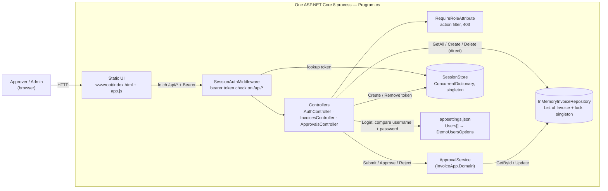
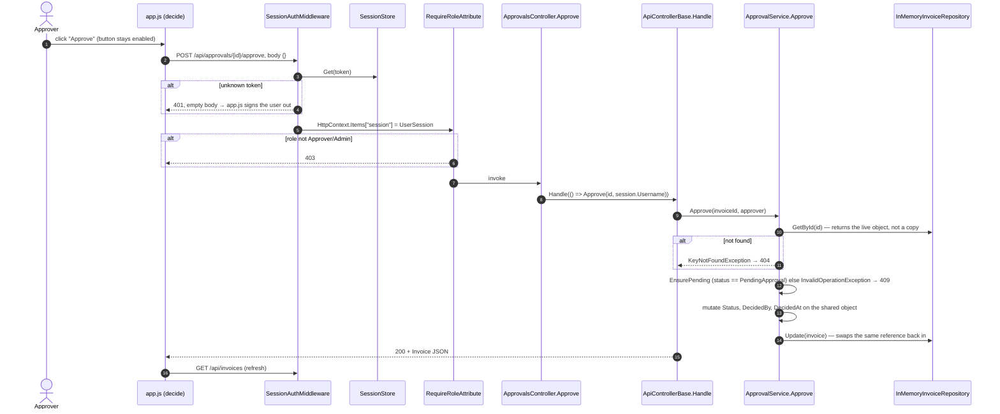

# As-built architecture: Invoice Approval service

This describes what the code does today, at commit `0616158` of the workshop repository. It deliberately ignores everything under `ops/`, because `ops/` describes the production deployment we are planning, not what runs. I kept the two apart on purpose. Once a diagram mixes "is" and "will be", nobody can tell which boxes are real.

The Mermaid sources live next to this file so they can be diffed in PRs:

- [`as-built-container.mmd`](as-built-container.mmd)
- [`as-built-approval-sequence.mmd`](as-built-approval-sequence.mmd)

## Container view



There's no database, no outbound HTTP, no message broker and no background worker. Everything lives in one process's memory, so a restart wipes all invoices and sessions.

## Sequence: approving an invoice



## Citations

Every element above maps to a file and a symbol. I checked each one by reading the file, not the README.

| Element | Where it comes from |
| --- | --- |
| Single process, static files served from the same host | `backend/src/InvoiceApp.Api/Program.cs`: `UseDefaultFiles()`, `UseStaticFiles()`, `MapControllers()` |
| Static UI | `wwwroot/index.html`, `wwwroot/app.js`: `api()`, `decide()`, `renderPending()` |
| Approve call path and empty body | `app.js`: `decide(\`/approvals/${invoice.id}/approve\`, {})` |
| Bearer token held in the browser | `app.js`: `sessionStorage.setItem('session', …)`, `headers.Authorization` |
| Middleware, 401, login bypass | `Auth/SessionAuthMiddleware.cs`: `InvokeAsync`, `needsSession` |
| Session lookup | `Auth/SessionStore.cs`: `Get`, `Create`, `Remove` (no expiry anywhere) |
| Role filter, 403 | `Auth/RequireRoleAttribute.cs`: `OnActionExecuting` |
| Approvers and Admins only on approvals | `Controllers/ApprovalsController.cs`: class-level `[RequireRole("Approver", "Admin")]` |
| Approver identity | `ApprovalsController.Approve`: `HttpContext.GetSession().Username` |
| Error mapping 404/409/400 | `Controllers/ApiControllerBase.cs`: `Handle` |
| Lifecycle rules | `InvoiceApp.Domain/ApprovalService.cs`: `Approve`, `Find`, `EnsurePending` |
| Repository contract | `InvoiceApp.Domain/IInvoiceRepository.cs` |
| In-memory store, per-call lock, seeded data | `InvoiceApp.Api/InMemoryInvoiceRepository.cs`: `_lock`, `_invoices`, `Update` |
| Lifetimes | `Program.cs`: `AddSingleton<SessionStore>`, `AddSingleton<IInvoiceRepository, InMemoryInvoiceRepository>`, `AddScoped<ApprovalService>` |
| Demo users from config, plaintext compare | `appsettings.json` `Users[]`; `Auth/UserSession.cs` `DemoUsersOptions`; `AuthController.Login` |
| Controllers bypassing the domain for reads/creates/deletes | `InvoicesController`: `GetAll`, `Create`, `Delete` use `_repository` directly |

## What the agent inferred rather than read

I had an agent draft the first version of both diagrams from the repository (prompt and output are in the [AI augmentation log](../ai-augmentation-log.md)). It produced a list of what it had inferred. I kept that list, and added the things I had to infer myself:

1. It's one OS process. Nothing in the repo (no Dockerfile, no infra-as-code) says how it's hosted. `Program.cs` builds one host, and that's all we know.
2. The middleware runs before the MVC filters, so the session is in `HttpContext.Items` by the time `RequireRole` reads it. That follows from the order in `Program.cs`. It isn't checked by a test.
3. The 401/403/404/409/400 outcomes come from reading the code. None of them was observed by running it.
4. "Approver/Admin in a browser" is the only actor. No machine-to-machine client exists.
5. The agent didn't open `appsettings.json` or `UserSession.cs`, so it inferred that the demo users come from config. I read both files: they do, and the passwords are compared in plaintext.

## What I corrected in the agent's draft

The draft was good. In particular, it correctly refused to draw PayEx, the database or Service Bus, because AGENTS.md says not to trust `ops/`. But four things were wrong or missing, and the first one matters for everything that follows:

1. The draft showed `Update(invoice)` as the point where the approval is persisted. That's wrong for this repository. `GetById` hands back the live object from the list, and `ApprovalService.Approve` mutates `Status` on that shared object before `Update` is called. The lock in the repository protects each call, not the read-check-write sequence. So two concurrent approve requests can both pass `EnsurePending`, and both return 200. Today that's harmless. Once an approval triggers a PayEx submission, it's a double payment. The INC-2041 logs in `ops/` show this pattern in the planned system: INV-41521 approved by two different users at 10:04 and 10:10, both returning 200. So the target state needs real optimistic concurrency (a SQL `rowversion`), not the current lock.
2. The draft had no node for the config file. The user directory is `appsettings.json`, so credentials ship with the build. That's fine for a demo, but it needs to be on the diagram because it's the first thing a SOC 2 auditor will ask about.
3. The draft drew the middleware fanning out to each controller, as if it were routing. Routing is `MapControllers()`; the middleware only checks the token. I redrew it as one hop.
4. The draft left out that `InvoicesController` talks to the repository directly for `GetAll`, `Create` and `Delete`. AGENTS.md says business rules belong in the domain. Deleting an invoice is a business decision, especially with a seven-year audit requirement, and right now it's a hard delete with no record left behind.

## Things the code and `ops/` disagree on

These are worth knowing before anyone reads an incident pack and assumes it describes this code:

| `ops/` or eval diffs say | The code actually has |
| --- | --- |
| Route `POST /api/invoices/{id}/approve` (INC-2041 logs) | `POST /api/approvals/{id}/approve` |
| `ApprovalService` registered as a singleton (deploy diff) | `AddScoped<ApprovalService>()` |
| Controllers use `CurrentUser`, `_logger`, `DecisionResponse` | `HttpContext.GetSession()`, no logger, controllers return `Invoice` |
| `[RequireRole("Approver")]` on each action | class-level `[RequireRole("Approver", "Admin")]` |
| `InMemoryInvoiceRepository` uses a `ConcurrentDictionary` (case-08) | `List<Invoice>` with a `lock` |
| `DiscountCalculator.Apply(amount, percent)`, static (case-03) | instance methods `QuantityDiscount`, `LoyaltyDiscount`, `CombinedDiscount`, `ApplyDiscount`; nothing calls them |
| `PayExClient`, `Notifications`, `EventPublisher`, Service Bus topic | none of these exist |

## The architecture test

There's one structural rule I care about most, because the target design depends on it. **The Domain project must not depend on web, storage or transport code.** AGENTS.md states it ("business rules, no web or storage code"). The outbox design in [ADR-001](../decisions/ADR-001-exactly-once-payex-submission.md) only works if the approval decision and the outbox row come out of a domain that knows nothing about HTTP or PayEx.

The test is [`backend/tests/InvoiceApp.Tests/ArchitectureTests.cs`](../../backend/tests/InvoiceApp.Tests/ArchitectureTests.cs). It reads the compiled `InvoiceApp.Domain` assembly's references and fails if any of them is ASP.NET Core, EF Core, a SQL client, Dapper, the Azure SDK, `System.Net.Http` or the Api project itself. A second check makes sure every public type in the Domain assembly lives under the `InvoiceApp.Domain` namespace, so nobody can sneak in an `InvoiceApp.Api.Something` type by namespace alone.

Run it:

```
dotnet test backend/InvoiceApp.sln --filter "FullyQualifiedName~ArchitectureTests"
```

It also runs in CI as its own step, so it's visible in the PR checks rather than buried in the unit test count.

I made sure it really fails when the rule is broken. On the feature branch I pushed a commit that added an `HttpClient` field to `ApprovalService`, watched CI go red on the architecture step, then reverted it. Both runs are linked in the PR description.
