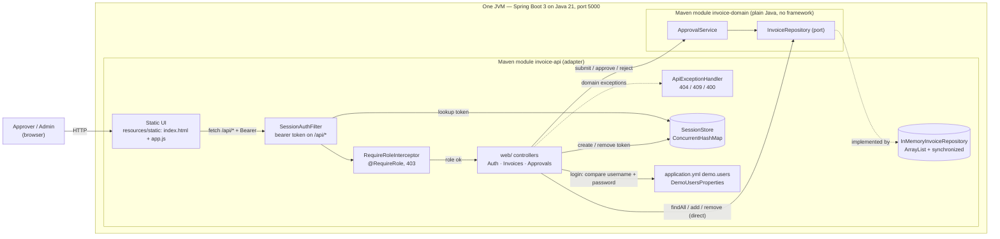
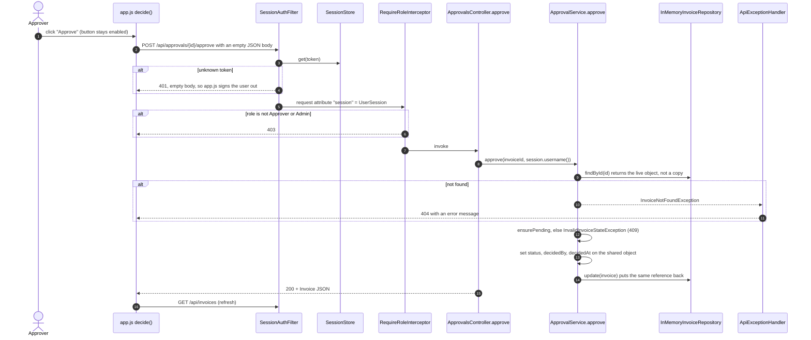

# As-built architecture: Invoice Approval service

This document describes what the code in `backend/` does today. It deliberately ignores everything under `ops/`. That folder describes the production deployment we're planning, not the system that runs now. If a diagram mixes "is" and "will be", nobody can tell which boxes are real, so I keep the two apart.

The service is Java 21 + Spring Boot 3, split into two Maven modules. Why this stack, and how the HTTP contract is pinned, is in [ADR-002](../decisions/ADR-002-java-spring-boot-stack.md).

**Where to see the diagrams:**

- The Mermaid blocks below render directly on GitHub.
- The same diagrams are also exported as SVG, which open anywhere: [container](img/as-built-container.svg), [approval sequence](img/as-built-approval-sequence.svg).
- The editable sources sit next to this file: [`as-built-container.mmd`](as-built-container.mmd), [`as-built-approval-sequence.mmd`](as-built-approval-sequence.mmd).
- [All diagrams in one place](README.md).

## Container view



<details><summary>Mermaid source of this diagram (from <code>as-built-container.mmd</code>), to paste into mermaid.live</summary>

```text
flowchart LR
    user["Approver / Admin<br/>(browser)"]

    subgraph jvm["One JVM — Spring Boot 3 on Java 21, port 5000"]
        direction LR
        subgraph apimod["Maven module invoice-api (adapter)"]
            ui["Static UI<br/>resources/static: index.html + app.js"]
            filter["SessionAuthFilter<br/>bearer token on /api/*"]
            ctrl["web/ controllers<br/>Auth · Invoices · Approvals"]
            roles["RequireRoleInterceptor<br/>@RequireRole, 403"]
            advice["ApiExceptionHandler<br/>404 / 409 / 400"]
            repo[("InMemoryInvoiceRepository<br/>ArrayList + synchronized")]
            sessions[("SessionStore<br/>ConcurrentHashMap")]
            cfg["application.yml demo.users<br/>DemoUsersProperties"]
        end
        subgraph dommod["Maven module invoice-domain (plain Java, no framework)"]
            svc["ApprovalService"]
            port["InvoiceRepository (port)"]
        end
    end

    user -->|HTTP| ui
    ui -->|"fetch /api/* + Bearer"| filter
    filter -->|lookup token| sessions
    filter --> roles
    roles -->|"role ok"| ctrl
    ctrl -->|"submit / approve / reject"| svc
    ctrl -->|"findAll / add / remove (direct)"| port
    svc --> port
    port -. implemented by .-> repo
    ctrl -.->|domain exceptions| advice
    ctrl -->|"login: compare username + password"| cfg
    ctrl -->|"create / remove token"| sessions
```

[Open this diagram in the Mermaid Live Editor](https://mermaid.live/edit#pako:eNp9VF1PGzEQ_Cure0rakByQqiqqUENpRSqiIgJ94frg2JvE4LNd25eQEv57177j81DvIbHX3vHseNZ3GTcCswPI5sqs-ZK5AKfnhQb6Ko_uqshG1jqzQgcDGIlS6s8zNzjszJxZ03q3yH4Xut7vq9nCMbuE61VJeT81wo9fEyiqvXx3CFPrpF7AkTEB9sFo-MFWDPZ2e2ANHfohz_OEBc0npEMeJG184PPiDGZlaQQdM2Er1EDjSiFIvTKS4w6tQocJZsMDRXj2VZLypoEFyeFynOpx6E3lOPqBT_EDghJ421-GUsF7Os32r30LaC5VSBpN0XuiOqrC8nuKJdAZMke6BXNDDKmQAdEavGuh8OAUYaxxNgBudHBGKXQ-QUREUjDPZx9hXBfnH-b1xTDV5kUI6AnyHP9UJOM5TceaWHG0wdTcvjxb68Ew32-BMLGi05IB5LfbmEoVnjAtVFPeMB-SJ4b5p_Sbt1mgNVedIhvrCZbGbRr-5xT2knhs6gqdY5tT6QPJ7DeaL53R8i-KIuu-wvO1yD5iNoJPCQYTzFejeeUc6nDC_HLCbDufzxdUDV2lkpzFYvobulxB3PrR6rXgxzS9jLMzZyy6IPGlvKjFG24UpvyPG2mVSQ0dq-Jf9H0PtIG5YyWujbtpO9Sv-GPnMTVFF6-itSs2zlXU95WudBKtdN_mnQZPDQ47O4fbk4uLsy21RROWKVhkcwx82biWbuco2bnIto3v6931OGUoY24qW_t9-3hdr7fV7qyjadicFsdgbiJ-7Ih6Qxw16yR2KQN5jdUPEo0cXtMbETNIsFbCnFp4pFTMECLtLmNap35ZujEt6tQ8XiueyD1F0rO00wdZWoUlGQsFzDbQjxWQ1M-Po9i2uWR86BS_bTqoxUuZhdQH1OqlJUHTLWhyAilsmfdkCJE0mC9amdwhC_hUSlI6lf-oddaDrERHXER81e-KLCyJfUGTIhM4Z5Uiwe7jNlYFM6WOo6XgKnoFssoKwj-WjFxdNuH7f54P-NE=)

</details>

There's no database, no outbound HTTP, no message broker and no background job. Everything lives in one process's memory, so a restart wipes all invoices and sessions.

## Sequence: approving an invoice



<details><summary>Mermaid source of this diagram (from <code>as-built-approval-sequence.mmd</code>), to paste into mermaid.live</summary>

```text
sequenceDiagram
    autonumber
    actor A as Approver
    participant JS as app.js decide()
    participant F as SessionAuthFilter
    participant SS as SessionStore
    participant RR as RequireRoleInterceptor
    participant AC as ApprovalsController.approve
    participant S as ApprovalService.approve
    participant R as InMemoryInvoiceRepository
    participant EH as ApiExceptionHandler

    A->>JS: click "Approve" (button stays enabled)
    JS->>F: POST /api/approvals/{id}/approve with an empty JSON body
    F->>SS: get(token)
    alt unknown token
        F-->>JS: 401, empty body, so app.js signs the user out
    end
    F->>RR: request attribute "session" = UserSession
    alt role is not Approver or Admin
        RR-->>JS: 403
    end
    RR->>AC: invoke
    AC->>S: approve(invoiceId, session.username())
    S->>R: findById(id) returns the live object, not a copy
    alt not found
        S-->>EH: InvoiceNotFoundException
        EH-->>JS: 404 with an error message
    end
    S->>S: ensurePending, else InvalidInvoiceStateException (409)
    S->>S: set status, decidedBy, decidedAt on the shared object
    S->>R: update(invoice) puts the same reference back
    AC-->>JS: 200 + Invoice JSON
    JS->>F: GET /api/invoices (refresh)
```

[Open this diagram in the Mermaid Live Editor](https://mermaid.live/edit#pako:eNp1VMFy2jAQ_ZUdn8yUJrTNpZ4pMy6FQmaaZuz2xkVYCyjYkiutkjKZ_HtXWOAkpJzw6u3ue29XekwqIzHJIHH4x6Ou8JsSGyuapQb-CU9G-2aFNn5XZCzkIBzkbWvN_fGgFZZUpVqhCa7LcC7a9uLOgcRKSUwH57BZQJXonDI697SdqZreKleWz4Al98dzTFEETMESlMXC1LjQXKvCluHn6HzSCxC1mxhN1tQ12gvRiXqDxPOMEu29qvD_6AObhf6BjbH7hb43jC6wNU4xn_05fjrvyqvp38CZdc6FlnVwowPn78fj6zKDqlbVDpZJNH-ZQLryxDMCR2LvALVY1Sij29clp80yuP1Z_oJL0apLcdR8-ajkU_xEeFC0BaEBm5b2nPbzBlZGRqIzLlJy7w1SSmaHOlYXNYHXO20eNBziXbhLiXyvRh-GsWooOARnjovh1EY7oC2Cd2jBeOryUcu-b1FkYMNiOgJBZBWrRdbvum1g_V_gN6fH7eiJ8TwRlANt6LSpEFZXNuoZ0aLomX561Z_PxuN8koHiAe7ilPNJcCOD6FyquuEuJEvrOFwEOVo0vPPRqDAF1rFWWn7dL2Sq5IBFkbdRf614BGZ1hxUND4QFVKbd92JCbG38kVhXk4tO5xnE7boxNAuI0wL10Om813jVj9patqNhzmKDr5SXnUbUzlu85bDSGx5j7TC0E7WSsWtJgvDUEtKr0efBixIOKWwmeTeMLwFbcPqbE3BWsMBthUUZTXjhmm8l9zj6PIDWU-eaY4vZxjXa8GrBSlS704ii3o-jEbw7OnRY65f34vs0XotY3UHKBS26LatIhpA0aBuhZHgeH5cJd234ymW8fxLXwte0TJ4CLLyS5V5XfETWI0c61vEpjeGnf942yP0=)

</details>

## Citations

Each element above maps to a file and a symbol. Paths are relative to `backend/`. I checked every one by opening the file, not by reading the README.

| Element | Where it comes from |
| --- | --- |
| One process, UI served by the same host | `invoice-api/.../InvoiceApprovalApplication.java` (`@SpringBootApplication`); `resources/static/index.html` is picked up by Spring Boot's welcome-page handling; `application.yml` sets `server.port: 5000` |
| Static UI and the approve call | `invoice-api/src/main/resources/static/app.js`: `api()`, `decide()`, `renderPending()`. It calls `` `/approvals/${invoice.id}/approve` `` with an empty body |
| Bearer token held in the browser | `app.js`: `sessionStorage.setItem('session', …)`, `headers.Authorization` |
| Filter, 401, login bypass | `invoice-api/.../auth/SessionAuthFilter.java`: `doFilterInternal`, `needsSession`. It's registered for `/api/*` in `config/WebConfiguration.java` |
| Session lookup, with no expiry anywhere | `auth/SessionStore.java`: `get`, `create`, `remove` |
| Role check, 403 | `auth/RequireRoleInterceptor.java`: `preHandle`. Class-level and method-level `@RequireRole` must both pass |
| Approvals limited to Approver/Admin | `web/ApprovalsController.java`: class-level `@RequireRole({"Approver", "Admin"})` |
| Approver identity | `ApprovalsController.approve`: `CurrentSession.of(request).username()` |
| Error mapping 404/409/400 | `web/ApiExceptionHandler.java` |
| Lifecycle rules | `invoice-domain/.../ApprovalService.java`: `approve`, `find`, `ensurePending` |
| Repository port | `invoice-domain/.../InvoiceRepository.java` |
| In-memory store with a lock per call, seeded data | `invoice-api/.../persistence/InMemoryInvoiceRepository.java`: `lock`, `invoices`, `update` |
| Domain wired without annotations | `invoice-api/.../config/DomainConfiguration.java`: `@Bean approvalService` |
| Demo users from config, compared in plaintext | `application.yml` `demo.users`; `auth/DemoUsersProperties.java`; `web/AuthController.login` |
| Controllers that bypass the domain for reads, creates and deletes | `web/InvoicesController.java`: `getAll`, `create` and `delete` call `repository` directly |
| The contract above is pinned by tests | `invoice-api/src/test/.../ApiContractTest.java` (10 MockMvc tests: 401, 403, 404, 409, 400, 201 + Location, JSON shape) |

## What the agent inferred, not read

I had an agent draft both diagrams from the code: a fresh session, allowed to read only `backend/` and none of the docs, so it couldn't borrow from `ops/` or from my analysis. The prompt and output are in the [AI augmentation log](../ai-augmentation-log.md). These are the inferences it listed, with its own confidence, and what I found when I checked:

| # | Inferred by the agent | Its confidence | Checked |
| --- | --- | --- | --- |
| 1 | The filter runs before the interceptor, which runs before the controller (Servlet and MVC ordering, not shown in code) | high | True. `ApiContractTest.deleteIsAdminOnly` depends on it |
| 2 | `@RequireRole` failures are 403 with an empty body, because `preHandle` only sets the status | high | True |
| 3 | Static files come from Spring Boot's default `classpath:/static` mapping; `GET /` serves `index.html` as the welcome page | high / medium | True. `ApiContractTest.staticUiIsServedWithoutSignIn` |
| 4 | It's one JVM with no other container, because the poms carry only web and test starters and there's no network or JDBC code | high | True for the code. Hosting isn't in the repo at all (no Dockerfile, no IaC) |
| 5 | Concurrent requests on Tomcat's thread pool can reach the check-then-act race | high | True. That's correction 1 below |
| 6 | Only the `Approver` and `Admin` roles exist, and `create` and `submit` are open to any signed-in user | high | True |
| 7 | Deployment, TLS and reverse proxy are unknown; the code shows plain HTTP on 5000 | n/a | True. That gap is a target-state item |

It also flagged risks I hadn't drawn: sessions never expire and the map grows without bound, `/api/auth/login` is matched by prefix, and `Invoice.createdAt` ignores the injected `Clock`. They're real and small. I've recorded them here rather than fixed them, so this document keeps describing what runs.

## What I corrected in the agent's draft

The draft was good: the structure, the citations and most of the risks were right. It named the check-then-act race, drew the config node and the repository bypass, and got the filter, interceptor and controller order right. It had four problems, and the first one shapes everything that follows:

1. **It found the race but not what it costs.** It described the race correctly: `findById` returns the live object, `ApprovalService.approve` changes it before `update`, and the repository's lock protects each call, not the read-check-write sequence. So two concurrent approvals can both pass `ensurePending`. But it stopped at "last write wins". Today that's harmless. Once an approval triggers a PayEx submission, it's a double payment.

   The INC-2041 logs in `ops/` show the planned system is worse: INV-41521 was approved by two different users, six minutes apart (10:04 and 10:10, both on web-02), and both calls returned 200. That isn't a concurrent race, it's a missing state check, and the same version check fixes both. So the target state needs real optimistic concurrency (a `@Version` / `rowversion` column), not the current lock.

   I've kept the race in the code on purpose, documented on `InMemoryInvoiceRepository` and `Invoice`, so this analysis still describes what runs. The fix belongs to ADR-001's persistence work, with its own tests.
2. **One risk it listed is wrong.** It said `AuthController.login` can fail with a 500 on a null username or password. It can't: `String.equals(null)` returns false, so the request gets a 401. It half-corrected itself in the same sentence. I dropped the item.
3. **It missed why the bypass matters.** It drew `InvoicesController` calling the repository directly for list, create and delete, but treated that as structure. AGENTS.md says business rules belong in the domain, and deleting an invoice is a business decision, especially with a seven-year audit requirement. Right now it's a hard delete, with no record kept.
4. **Error mapping was folded into the controllers.** I drew `ApiExceptionHandler` as its own node, because the 409 it returns is exactly what the version check in the target design will produce. It's part of the approval path, not a detail of the controller.

## Things the code and `ops/` disagree on

Read this before you read an incident pack and assume it describes this code. The evidence packs and eval diffs come from the workshop and were written against its reference app, so names differ twice: once between that app and this code, and once from "planned" to "built".

| `ops/` or eval diffs say | What the code actually has |
| --- | --- |
| Route `POST /api/invoices/{id}/approve` (INC-2041 logs) | `POST /api/approvals/{id}/approve` |
| `ApprovalService` registered as a singleton with a PayEx client injected (deploy diff) | a plain `ApprovalService` bean with only a repository and a clock, and no PayEx client anywhere |
| Controllers use `CurrentUser`, `_logger`, `DecisionResponse` | `CurrentSession.of(request)`; no logger; controllers return `Invoice` |
| `[RequireRole("Approver")]` on each action | class-level `@RequireRole({"Approver", "Admin"})` |
| The in-memory repository uses a concurrent dictionary (case-08) | an `ArrayList` guarded by `synchronized` |
| A static `DiscountCalculator.Apply(amount, percent)` (case-03) | instance methods `quantityDiscount`, `loyaltyDiscount`, `combinedDiscount`, `applyDiscount`. Nothing calls them |
| `PayExClient`, `Notifications`, `EventPublisher`, a Service Bus topic | none of these exist |

## The architecture test

There's one structural rule I care about most, because the target design depends on it: **the domain module must not depend on web, storage or transport code.** The outbox design in [ADR-001](../decisions/ADR-001-exactly-once-payex-submission.md) only works if the approval decision and the outbox row come from a domain that knows nothing about HTTP or PayEx.

The rule is enforced in two layers, and the second is the one that actually matters:

1. **The Maven module boundary.** `invoice-domain/pom.xml` has no runtime dependencies at all, so the domain can't even import Spring, Jakarta or an AWS or Azure SDK. The build fails before any test runs.
2. **ArchUnit**, in [`invoice-domain/src/test/java/com/invoiceapproval/domain/DomainArchitectureTest.java`](../../backend/invoice-domain/src/test/java/com/invoiceapproval/domain/DomainArchitectureTest.java). Maven can't stop `java.net.http.HttpClient` or `java.sql.Connection`, because both ship with the JDK. To be precise about scope: this rule would not have caught INC-2041, because that per-call `HttpClient` lived in the PayEx adapter, not the domain. What it protects is the outbox design: the approval decision must not be able to call out. The adapter-level guard is the single shared client bean in ADR-001. The rule is an **allow-list**: domain classes may depend only on `java.lang`, `java.util`, `java.math`, `java.time` and the domain package itself. A deny-list only blocks what someone happened to think of; an allow-list fails on anything new.

Run it:

```
./backend/mvnw -f backend/pom.xml -pl invoice-domain test -Dtest=DomainArchitectureTest
```

It also runs in CI as its own step, "Architecture rules (ArchUnit)", so a violation is visible in the PR checks instead of being buried in the test count.

I checked that it actually fails when the rule is broken. On the feature branch I pushed a commit that added a `java.net.http.HttpClient` field to `ApprovalService`. The Maven build was happy, ArchUnit reported two violations (the field type and the constructor call), and the CI step went red. I then reverted it. Evidence, PR #3: [violation run (red)](https://github.com/aranimondal/invoice-approval-prod-readiness/actions/runs/41603996505) and [revert run (green)](https://github.com/aranimondal/invoice-approval-prod-readiness/actions/runs/41604156932).
