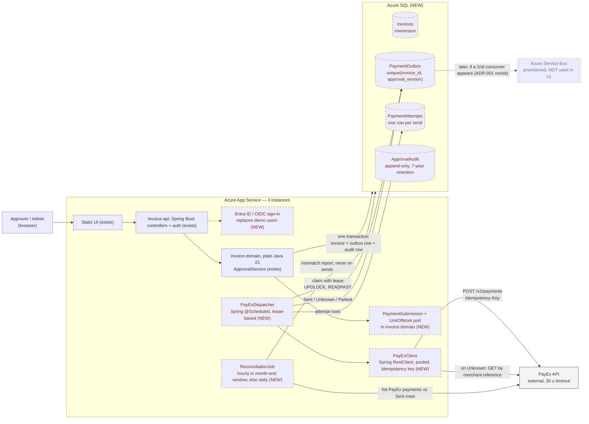
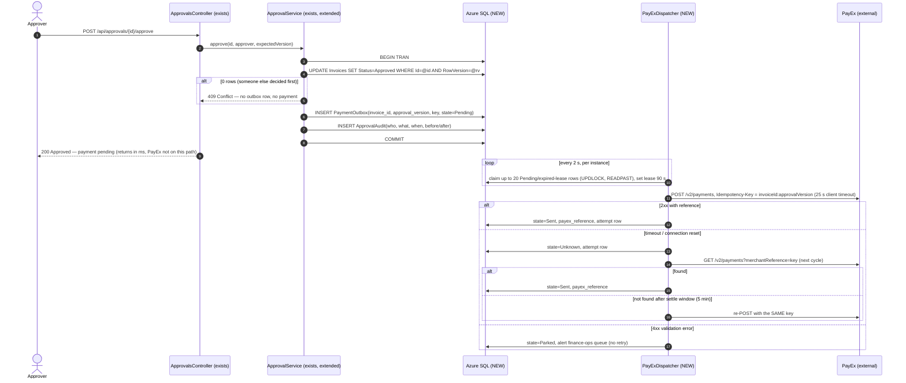

# Target state: persistence and PayEx in place

This is where we want to be by the January go-live. **Anything drawn with a dashed orange border doesn't exist in the code yet.** Solid boxes exist today, sometimes with a small extension that's called out in the label. Service Bus has a grey dotted border: it's provisioned in Azure, and on purpose nothing uses it in v1. [ADR-001](../decisions/ADR-001-exactly-once-payex-submission.md) explains why.

The Mermaid blocks below render on GitHub. The same diagrams are exported as SVG ([container](img/target-container.svg), [sequence](img/target-approval-sequence.svg)), and the editable sources are [`target-container.mmd`](target-container.mmd) and [`target-approval-sequence.mmd`](target-approval-sequence.mmd).

## Container view



<details><summary>Mermaid source of this diagram (from <code>target-container.mmd</code>), to paste into mermaid.live</summary>

```text
flowchart LR
    user["Approver / Admin<br/>(browser)"]
    payex["PayEx API<br/>external, 30 s timeout"]:::external

    subgraph app["Azure App Service — 3 instances"]
        direction TB
        ui["Static UI (exists)"]
        api["invoice-api: Spring Boot controllers + auth (exists)"]
        oidc["Entra ID / OIDC sign-in<br/>replaces demo users (NEW)"]:::planned
        domain["invoice-domain, plain Java 21<br/>ApprovalService (exists)"]
        paysub["PaymentSubmission + UnitOfWork port<br/>in invoice-domain (NEW)"]:::planned
        disp["PayExDispatcher<br/>Spring @Scheduled, lease-based (NEW)"]:::planned
        payexc["PayExClient<br/>Spring RestClient, pooled, idempotency key (NEW)"]:::planned
        recon["ReconciliationJob<br/>hourly in month-end window, else daily (NEW)"]:::planned
    end

    subgraph sql["Azure SQL (NEW)"]
        inv[("Invoices<br/>rowversion")]:::planned
        outbox[("PaymentOutbox<br/>unique(invoice_id, approval_version)")]:::planned
        attempts[("PaymentAttempts<br/>one row per send")]:::planned
        audit[("ApprovalAudit<br/>append-only, 7-year retention")]:::planned
    end

    sb[["Azure Service Bus<br/>provisioned, NOT used in v1"]]:::unused

    user --> ui --> api --> domain
    api -.-> oidc
    domain --> paysub
    domain -->|"one transaction:<br/>invoice + outbox row + audit row"| sql
    disp -->|"claim with lease<br/>UPDLOCK, READPAST"| outbox
    disp --> payexc -->|"POST /v2/payments<br/>Idempotency-Key"| payex
    payexc -->|"on Unknown: GET by merchant reference"| payex
    disp -->|"Sent / Unknown / Parked"| outbox
    disp -->|"attempt rows"| attempts
    recon -->|"list PayEx payments vs Sent rows"| payex
    recon -->|"mismatch report, never re-sends"| sql
    outbox -. "later, if a 2nd consumer appears (ADR-001 revisit)" .-> sb

    classDef planned stroke-dasharray: 5 5,stroke:#b45309,color:#7c2d12;
    classDef external fill:#f3f4f6,stroke:#374151;
    classDef unused stroke-dasharray: 2 4,stroke:#9ca3af,color:#6b7280;
```

[Open this diagram in the Mermaid Live Editor](https://mermaid.live/edit#pako:eNp9Vu9T2zgQ_Vd2zBcY4pIfUK6-m84FwtykZZocgekHctORbYVosCVXkhNybf_3e5LsEDggH4hZ775dvX27yo8oUzmPEooWhVpnS6YtXV7NJeFTG65v59GwqrRacU1HNMxLIf9I9dHH_VSrNd4fzKN_gnfFNvwB7lO2uXig4XTs_fiD5VqyokODLhmyouSqtghKkqR9N5cBwdTpnWbVklhVubz_1poTstOM65XIOM3rfrd3TAMS0lgmM2622d0nF5pnVihJ12eP1loAa2aZFRndjGmfPwhjzcGTSFY5JyFXCmli_JfQrNJC3tGZUpYyJa1WRcG1oUNitV2-DKNEngHnAt6MxiMQNhmPzsmIOxk3vGleFQyFU85L5Rk2tP_l4utBoAQvpeT5zplUyYTcKS4YOgRPIekTWzHq9zx06BMrWrZeLBFdAs2hTSWXdlanpTDGkXZIN1LYyeKr0vdUKW09KpI8Tf12ucJUrQZGeGY2W3LtgRpC_5zBktcFzztUcGZ4nOJP_iaql1bW4p4XAoXvYl5xY4MVvCjlsQUIrpTlMtvQPd-8iQ_ZKMfxlfvORCGYU9EnlfokS1XrYgMWqIQOljGXOa2FzNW6Q7wwnHImitcTwP1_Ajffi63AZ39fbmMfSwLnt_vzaByoN0E7ao0xdL2aRwcvHgSjlaoHF9i0d-INPrqW4nvN95tmfhPgiDWK-dbAHryGy6wFm9bsIA8bk8dWkhOqowpbwrgDv4ZT58I6kFarQ2fwEKgFgbGSxaZDp_GGM42-oH_2lfPu8prePtLZqP-sDqW5PMIdzoniy-TazVzumrnqgXCHWktnarHcSFIcf8Te8F9YBv47iD_4eNs7GN3AB1MzG84zjNhz88955FjCZpCG-S2VNPPl-4HpC83zPB4GptzzPPrp5NLAYaQasAzzX0KH2EV-jDzYzXR0OTn_3KGri-FoOpxdu-iA-xSgGakGazqZXdPRqn9Uhd4G5saPExR_5hsH5aN21n22PRl2x71Ua5nQXxfXlG6o5Bq3icQZ-IJrgPBnADtnmSEnlmUDgacp0_doySvFI6IRpCPIOLdWoMHRz3PjWWAHUriT2tPRypBP2UbvVLUbisVYugUGo1uHHZLcXYOax07j5klnmubF7wgpGe41bKAFYTdjWQDR1ODDzRtkjYU_HF3F3W4PUE6bFnNHTk4mbVWI7hoz4gtqJE8GF9A9VjAzuKI12yR0QiedYE320uOTQfdDJ1OF0sneadbPe_3fnyG1ty0tRFEke4vB4njxfoswOD3unfSex4TReCF5n463oR8yNmCLNvn79LT_WxdAUYciHBr6z93Pix_zyC55CRUkoCjnC1YX-B3wy7nhRlWzjczwyuqaw1JXOUgcCYZ9WTbmX_8BOCbb7w==)

</details>

## Approval and payment sequence

Everything from the SQL transaction onwards is new.



<details><summary>Mermaid source of this diagram (from <code>target-approval-sequence.mmd</code>), to paste into mermaid.live</summary>

```text
sequenceDiagram
    autonumber
    actor A as Approver
    participant API as ApprovalsController (exists)
    participant S as ApprovalService (exists, extended)
    participant DB as Azure SQL (NEW)
    participant D as PayExDispatcher (NEW)
    participant P as PayEx (external)

    A->>API: POST /api/approvals/{id}/approve
    API->>S: approve(id, approver, expectedVersion)
    S->>DB: BEGIN TRAN
    S->>DB: UPDATE Invoices SET Status=Approved WHERE Id=@id AND RowVersion=@rv
    alt 0 rows (someone else decided first)
        S-->>API: 409 Conflict — no outbox row, no payment
    end
    S->>DB: INSERT PaymentOutbox(invoice_id, approval_version, key, state=Pending)
    S->>DB: INSERT ApprovalAudit(who, what, when, before/after)
    S->>DB: COMMIT
    API-->>A: 200 Approved — payment pending (returns in ms, PayEx not on this path)

    loop every 2 s, per instance
        D->>DB: claim up to 20 Pending/expired-lease rows (UPDLOCK, READPAST), set lease 90 s
    end
    D->>P: POST /v2/payments, Idempotency-Key = invoiceId:approvalVersion (25 s client timeout)
    alt 2xx with reference
        D->>DB: state=Sent, payex_reference, attempt row
    else timeout / connection reset
        D->>DB: state=Unknown, attempt row
        D->>P: GET /v2/payments?merchantReference=key (next cycle)
        alt found
            D->>DB: state=Sent, payex_reference
        else not found after settle window (5 min)
            D->>P: re-POST with the SAME key
        end
    else 4xx validation error
        D->>DB: state=Parked, alert finance-ops queue (no retry)
    end
```

[Open this diagram in the Mermaid Live Editor](https://mermaid.live/edit#pako:eNqVVV9v2joU_ypHeQpSEFzUPQyJ3aUl2tBWmhF294JUufFhWE3szHaArOp333HiFLqxh4sEIsk5x79_dp6CXHEMphAY_FGjzHEu2HfNyo0E-rDaKlmXD6j9dW6VhhiYgbiqtNr3DyqmrchFxaSFOF2cClhhbpS0WhUFagjxKIw1gz-bsvOWDPVe5NiXR4BHi5Ijv9A4v247f9YaIfvyGcJl8u1SmatKWZMc58JUzOY7B-dybfpS6xBY1JIVVNYVxsN374jhFNK7bA0jVgn6eqajJ8Gf_SX68nRBDdkU_N1Q8Kj_rx2xCnOL_D_URijpwWTUMr-ewnXyYbGE9Spevr7_NZ3H6wQWcq9IJgNZsobMMlubmbeFw7ePyYpK-Oy94BAv57BSB7_K7L3eez8LC2PQ6mAgNKpEJRGwMAgcc0F6w1ZoYz2qDkFP_2r8FsjZbSFyC5t6Mv7nCqQCVdsHdXQjI3dZsaZEabsBZOFrHotllqzWTmpXdNe2hqJjdX8SihX3-w55BI_YRGCIK85Smifk98HFmX2U4poLGx52KoLDjln3izTmAbdK44htyd3fBtzc3d4u1if3HOEpTMZjeNHW0_XkoOqAQKjR1loaEBJKSm0XIaksKAl2Jwx12N1LkgqlKkBi1sAEqLyiRApJ3GgXnhSfe1h5wUQJdQVWERjw5EcUIKGRDwtkZFvnJMXj893NpwhWSTxP42w9IMnQQlfzdgzmNz_cGmmf6P1k5IkRpgXHslK0-fJm-AkbmIG3Z8GnvTk-VRBO3oAhnMJpYgWlqe6j43I2OR7hIOwONG5R40WSnbEZDYicuni8fymmMFhLYKwj6fG7pPqFYAS5kpI2k4Oikfj-bfxX-SjVQV4YeKbFh-S1FP-WqPMdnQ6rHtCMogihpAMC8iYv8GyXOLpbVffy_g-Wp4aWnMtOOwjapDoXbYEko-TqAOEbKIUc_LkI4dc4bO1sFbc7Ohvj28TtnrMVenztUldkD5kpOGsVRK2V_puCKdOP6LYnnekEUEgX2aGqDNA7pKZzm3Y-7QXdDM6CFkQQkIglE9y9b542AcEqcUMXm4DjltWF3QTPrsy9drJG5vTI6pqsD-qKcPXvJn_7-RfkbSo5)

</details>

## What doesn't exist yet, and what has to be true first

| Part | Status | Hard dependency |
| --- | --- | --- |
| Azure SQL schema (`Invoices`, `PaymentOutbox`, `PaymentAttempts`, `ApprovalAudit`) | not started | Flyway migrations in `invoice-api` (plain SQL, see below) |
| `InvoiceRepository` JDBC adapter (`JdbcClient`) with a `rowversion` check | not started | schema |
| `ApprovalService` writing the outbox row in the same unit of work | not started | a small `UnitOfWork` port in `invoice-domain`, implemented in `invoice-api` with Spring's `TransactionTemplate`, so the ArchUnit rule still passes |
| `PayExDispatcher` (`@Scheduled` + `SmartLifecycle` for a clean stop on shutdown) | not started | PayEx answers the idempotency question (ADR-001, open question 1) |
| `PayExClient` on Spring `RestClient` over one shared, pooled JDK `HttpClient` (connect 5 s, read 25 s) | not started | API key in Key Vault, not `application.yml` |
| Reconciliation job | not started | a PayEx "list payments by date" endpoint, to be confirmed |
| Entra ID sign-in | not started | IT ticket for the app registration |
| Service Bus | provisioned, unused | only if a second consumer of approval events appears |

A few choices in that table are worth explaining.

**Flyway plus `JdbcClient`, not JPA/Hibernate.** The domain must stay free of storage code, which is what the ArchUnit rule enforces, so JPA annotations on `Invoice` are out anyway. And the outbox claim query uses `UPDLOCK, READPAST` hints. Hand-written SQL makes those visible in review. An ORM would generate the claim query for us, and that's exactly the query I want a reviewer to read line by line.

**The idempotency key is `invoiceId:approvalVersion`, not just the invoice ID.** UC-2 (partial approval) is on the roadmap. Once an invoice can be partially approved and later topped up, the invoice ID alone stops being a unique payment instruction. The agent got this right during the 3 a.m. stress test, after initially suggesting the bare invoice ID.

**One shared HTTP client, never one per call.** INC-2041 was a `new HttpClient()` per request. In Java, `HttpClient.newHttpClient()` inside a method is the same bug. The client is a singleton bean, and the ArchUnit rule keeps it out of the domain.

**The dispatcher runs inside the App Service instances, not as a separate Function.** At 80 approvals a minute peak, a separate compute unit costs more in moving parts than it saves. The lease column means three instances can run it safely. If it ever needs to scale independently, moving it out is a hosting change, not a design change.

## What stays the same

The UI, the role model, and the Draft → PendingApproval → Approved/Rejected lifecycle stay as they are. The approval API keeps its route and response shape. The only visible difference for an approver is that the response now means "approved, payment queued" rather than "done". The UI should say so, because at month-end the payment can lag the approval by minutes.

## If this ran on AWS instead

The scenario fixes the platform as Azure, so the design above is written in Azure terms. Nothing in it depends on Azure, though. The domain module doesn't know which cloud it's on, and the adapter choices map one-to-one:

| Concern | Azure (scenario) | AWS equivalent | What changes in code |
| --- | --- | --- | --- |
| Compute, 3 instances | App Service | ECS on Fargate behind an ALB, or EKS | nothing; it's the same Spring Boot jar in a container |
| Relational store | Azure SQL | RDS / Aurora PostgreSQL | the claim query becomes `SELECT … FOR UPDATE SKIP LOCKED`, and `rowversion` becomes an integer `version` column. Both are Flyway migrations |
| Secrets | Key Vault | Secrets Manager | the property source only |
| Messaging, if ever needed | Service Bus topic | SNS topic + SQS queue per consumer | a publisher adapter. The outbox stays the source of truth on either cloud |
| Sign-in | Entra ID | Cognito, or the corporate IdP over OIDC | Spring Security OAuth2 resource-server config |
| Logs and metrics | Application Insights | CloudWatch / X-Ray via OpenTelemetry | exporter config only, if we instrument with OpenTelemetry from day one |

A Quarkus host would work the same way: `invoice-domain` would be wired with a CDI producer instead of `DomainConfiguration`. That's the practical payoff of keeping framework annotations out of the domain.
